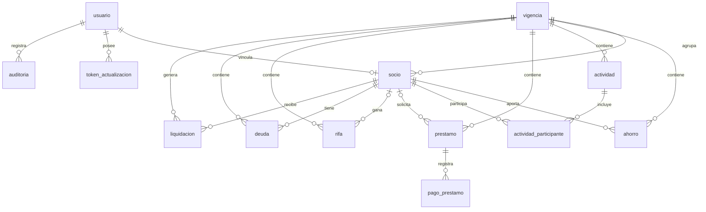

# Modelo ER

Consulte `backend/prisma/schema.prisma` para tipos, PK, FK, UNIQUE, CHECK implícitos e índices.

La cartera vigente se deriva de `prestamo` y `pago_prestamo`; la tabla `deuda` se conserva únicamente por compatibilidad con datos históricos y ya no es la fuente de las deudas mostradas por la aplicación.
